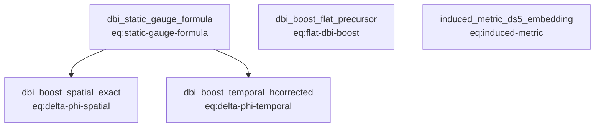

# Claim dependency graph

Generated from `claims.json` by `generate_views.py` -- do not hand-edit.
An arrow `A --> B` means claim B depends on (cites as a premise) claim A.

**Claim count:** 5 citable claims (0 given, 5 established).
